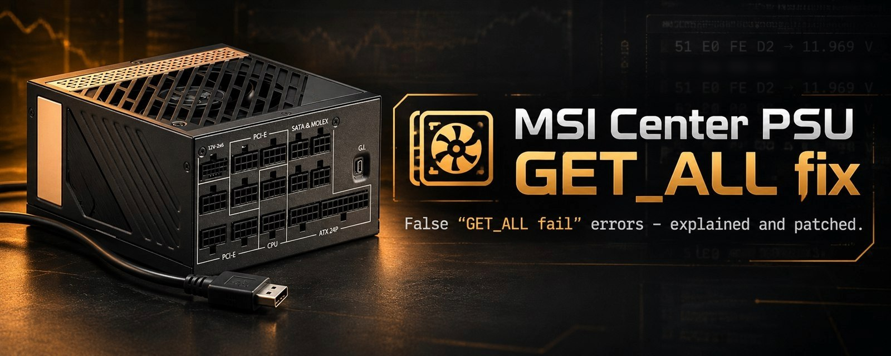
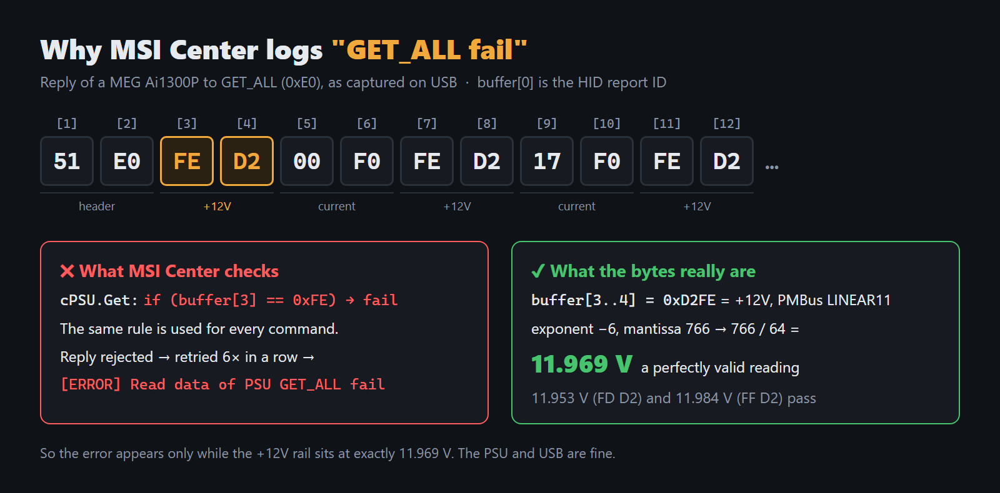
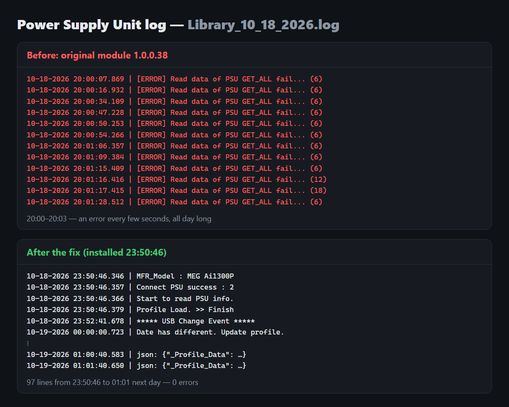
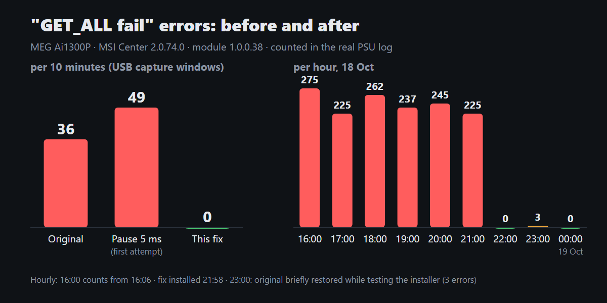

[English](README.md) | [中文](README.zh-CN.md) | [Español](README.es.md) | **Português**



# MSI Center: correção para "Read data of PSU GET_ALL fail"

Se você tem uma fonte MSI com monitoramento por USB (presente na **MEG Ai1300P**) e usa o MSI Center, o log do Power Supply Unit provavelmente está cheio de linhas como esta:

```
10-18-2026 21:50:01.933 | [ERROR] Read data of PSU GET_ALL fail... (6)
```

Elas aparecem de 3 a 5 vezes por minuto, cerca de 5.000 por dia. **Sua fonte e sua USB estão bem.** O erro vem de um bug no próprio MSI Center, e este repositório o corrige com um patch.

## O que está errado

Uma vez por segundo, o MSI Center pede à fonte todas as suas leituras (comando `0xE0`, GET_ALL). A resposta é uma lista de valores PMBus LINEAR11: +12V, as correntes de cada rail de 12V, +5V, +3.3V e assim por diante.

A verificação de resposta do módulo (`cPSU.Get` em `API_Power Supply Unit.dll` 1.0.0.38) considera a resposta um erro sempre que o byte 3 é `0xFE`. Essa regra vale para todos os comandos. Só que, no GET_ALL, o byte 3 é o byte baixo da **leitura de +12V**. Quando a fonte informa exatamente **11,969 V** (`0xD2FE`), o MSI descarta uma resposta válida. Ele tenta de novo 6 vezes seguidas, sem pausa, recebe a mesma tensão todas as vezes e registra `GET_ALL fail`. O número entre parênteses é um contador de falhas em andamento, não um código de erro.

Ou seja, a frequência do erro depende de o seu +12V cair justamente em 11,969 V. Não tem relação com USB, cabos, AIDA64/HWiNFO/iCUE nem com a carga. Detalhes e provas: [docs/technical.md](docs/technical.md) (em inglês).



## Meu PC é afetado?

Execute no PowerShell (não precisa de administrador):

```powershell
powershell -ExecutionPolicy Bypass -File scripts\check-log.ps1
```

O script conta as linhas `GET_ALL fail` por hora no log de hoje.



## O que o patch faz

Ele insere 3 instruções IL em `cPSU.Get`: `if (cmd == 0xE0) skip the 0xFE check`. Nada mais no módulo muda, e os outros comandos continuam com a verificação original.

Medido em uma MEG Ai1300P durante 10 minutos:

| | erros no log | requisições GET_ALL | respostas com +12V = 11,969 V aceitas |
|---|---|---|---|
| original | 36 | 1199 | 0 |
| com patch | **0** | **594** (uma por segundo) | **67 / 67** |

Na prática:
- o log fica limpo;
- nenhum segundo de leituras é perdido;
- a fonte não recebe mais rajadas de 6 tentativas.

O comportamento da fonte não é alterado. O modo single/multi rail, a OCP e configurações do ventilador não são afetados.

**Este repositório não contém nenhum arquivo da MSI.** O patcher pega a DLL instalada *no seu PC*, confere o SHA-256 e aplica o patch em uma cópia.



## O jeito mais fácil: deixe um agente de IA fazer

Se você usa um agente de programação com IA (Claude Code, Codex, Cursor, modo agente do Copilot etc.), abra a pasta deste repositório nele e cole:

```
Leia o AGENTS.md desta pasta e siga-o para verificar se meu PC é afetado pelo bug "GET_ALL fail" do MSI Center e, se for, aplicar a correção. Pergunte-me antes de cada etapa que altere meu sistema.
```

O [AGENTS.md](AGENTS.md) guia o agente por todo o processo com segurança:
- verificar o log;
- conferir o hash do módulo e recusar versões não suportadas;
- instalar o .NET SDK, se necessário;
- explicar o que vai mudar e pedir confirmação antes de fazer;
- executar o instalador;
- verificar o resultado.

## Download

**Code → Download ZIP** nesta página e extraia onde quiser. Ou use `git clone https://github.com/lostintired/msi-psu-getall-fix`.

## Requisitos

- Windows 10/11 e MSI Center com o componente Power Supply Unit, módulo na versão **1.0.0.38**. Outras versões são recusadas e nada é alterado.
- [.NET 10 SDK](https://dotnet.microsoft.com/download), usado para compilar o patcher.
- Direitos de administrador.

## Instalação

Execute em um PowerShell **como administrador**, a partir da pasta do repositório:

```powershell
powershell -ExecutionPolicy Bypass -File scripts\install.ps1
```

O script:
1. verifica se o módulo é o 1.0.0.38 original (SHA-256 `F7833895…0274BB`);
2. copia o módulo para `C:\Program Files\MsiPsuGetAllFix\` como backup;
3. compila o patcher, aplica o patch na cópia e confere o resultado (SHA-256 `6535FEB9…5D2B46`; o patch é determinístico);
4. troca o módulo e reinicia o `MSI_Center_Service`. O MSI Center recarrega todos os seus componentes, o que leva alguns segundos;
5. registra a tarefa agendada **"MSI PSU GET_ALL fix guard"**. Ela roda no logon e todos os dias:
   - se uma atualização do MSI Center restaurou a 1.0.0.38 original, aplica o patch de novo;
   - se aparecer uma versão *diferente*, não altera nada e mostra uma notificação. A MSI pode ter corrigido o bug, ou o patcher precisa ser atualizado.

Use `-NoGuard` para não criar a tarefa, ou `-MsiCenterDir "D:\...\MSI Center"` se o MSI Center não estiver na pasta padrão.

Para conferir depois: rode `scripts\check-log.ps1` após alguns minutos. Não devem aparecer novas linhas depois do horário da instalação.

## Desinstalação

```powershell
powershell -ExecutionPolicy Bypass -File "C:\Program Files\MsiPsuGetAllFix\uninstall.ps1"
```

Isso restaura o módulo original, reinicia o serviço e remove a tarefa e a pasta de instalação.

## Ressalvas

- A assinatura Authenticode da MSI na DLL com patch deixa de ser válida. O MSI Center não verifica isso (ele carrega os componentes com `Assembly.LoadFile`), mas o antivírus pode reclamar.
- Só o módulo 1.0.0.38 é suportado. Uma futura atualização da MSI pode corrigir o bug ou mudar o código. Nos dois casos, a tarefa de proteção não mexe no módulo novo.
- Testado em um único sistema: MEG Ai1300P (USB `VID_0DB0&PID_56D4`), MSI Center 2.0.74.0, SDK 3.2026.0911.01. O mesmo caminho de código atende outros dois modelos de fonte (IDs de produto 59209 e 51691). Relatos de outros modelos são bem-vindos.
- Use por sua conta e risco. Este projeto não é afiliado à MSI. O bug foi reportado ao suporte da MSI.

## Licença

MIT para o código deste repositório. O MSI Center e seus componentes pertencem à MSI.
